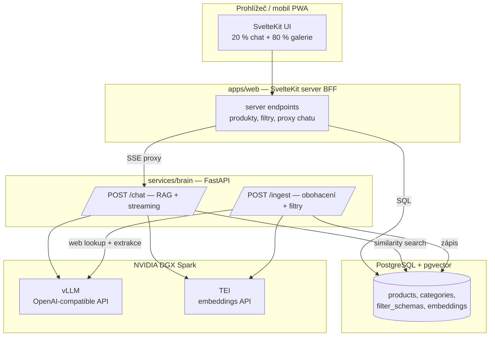

# Architektura — ChatShop

Zadání: [Prompts/00-PLAN-manual.md](Prompts/00-PLAN-manual.md)

## Přehled vrstev



## Deployment

### NAS (Ubuntu, docker compose) — aplikační vrstva

Vše aplikační běží na NAS přes `infra/nas/docker-compose.prod.yml`:

| Kontejner | Image | Role |
|---|---|---|
| `caddy` | caddy:2 | Reverse proxy, veřejná doména, automatický Let's Encrypt TLS |
| `web` | build `apps/web/Dockerfile` | SvelteKit (adapter-node), BFF |
| `brain` | build `services/brain/Dockerfile` | RAG chat + **ingest LLM pipeline** (orchestrace) |
| `db` | pgvector/pgvector:pg17 | PostgreSQL + pgvector, volume na NAS |

Veřejně je vystavený **jen Caddy (80/443)**; web, brain i DB jsou na interní
docker síti. Doména se nastavuje v `infra/nas/Caddyfile`.

### SPARK (NVIDIA DGX) — inference vrstva

Modul Shopify v AiStacku na Sparku: LLM `shop` (chat + extrakce atributů
při ingestu) a embeddingy `shop-embed` (bge-m3) za LiteLLM gatewayí. Spouští
se jen přes `sparkctl` (broker); vlastní compose pro Spark repo nemá. Spark není vystavený do
internetu — brain na NAS na něj volá po LAN/VPN přes `LLM_BASE_URL` /
`EMBEDDINGS_BASE_URL`. Ingest *pipeline* (orchestrace, DB zápisy) tedy běží
na NAS v brainu; *inference* (LLM, embeddingy) na Sparku.

### Mobile — PWA

Mobil = **PWA** instalovaná z veřejné domény (manifest + service worker jsou
součástí webu, HTTPS přes Caddy je podmínkou instalace). Nativní obal
(Expo/Capacitor) nad stejným BFF API je možný v pozdější fázi.

### Dev (Mac)

`npm run dev` + `uvicorn --reload` + lokální Postgres z
`infra/docker-compose.yml`; LLM buď vzdáleně na Sparku, nebo mock režim.

## apps/web — SvelteKit + TypeScript + Tailwind

- **Layout hlavní stránky**: horní panel (~20 % výšky, roztažitelný) = chat;
  zbytek = galerie.
- **Chat**: pole s promptem, streamovaná odpověď (SSE), pod odpovědí karty
  doporučených produktů (id produktů vrací brain v metadatech streamu).
- **Galerie**: velké obrázky, název, cena, tlačítko „Do košíku".
  Košík v `localStorage` (1. fáze bez objednávek).
- **Filtry**: sidebar se renderuje **dynamicky z filter schémat** vybrané
  kategorie — komponenty podle `kind`: `text` (fulltext), `range` (slider
  min–max, např. cena, kapacita TB), `set` (checkboxy, např. velikosti S–XL
  nebo barvy), `bool` (checkbox).
- **BFF endpointy** (`src/routes/api/`): `GET /api/products` (filtrování
  se překládá na SQL nad JSONB atributy), `GET /api/categories`
  (včetně filter schémat), `POST /api/chat` (proxy SSE na brain).
- **Admin** `/admin/ingest`: formulář (název / EAN / URL) → `POST` na brain
  ingest, zobrazení extrahovaných atributů k revizi.

## services/brain — Python FastAPI

### Chat (RAG)

1. Dotaz uživatele → embedding (TEI / mock).
2. pgvector cosine similarity nad `product_embeddings` → top-N produktů.
3. Prompt = systémová instrukce + kontext produktů (název, cena, atributy) +
   historie konverzace → vLLM (OpenAI-compatible `chat.completions`, stream).
4. SSE stream: tokeny odpovědi + závěrečný event `products` s id doporučených
   položek (model je vybírá nástrojem/instrukcí „vrať id relevantních položek").

**Mock režim** (bez `LLM_BASE_URL`): odpověď se poskládá šablonou z výsledků
vyhledávání; embedding se nahradí deterministickým hash-vektorem. Vše ostatní
(SSE protokol, doporučené produkty) funguje stejně — UI jde vyvíjet bez GPU.

### Ingest pipeline

Vstup: název / EAN / URL položky.

1. **Lookup**: dohledání informací o položce na webu (1. fáze: stub +
   možnost vložit text/URL ručně; později SearXNG nebo komerční search API).
2. **Extrakce**: LLM dostane dohledaný text + JSON schéma a vrátí strukturované
   atributy (`{"size": ["S","M","L"], "color": "černá", "capacity_tb": 4, ...}`).
3. **Filter schema merge**: atributy se promítnou do `filter_schemas` kategorie —
   nové hodnoty rozšíří `set` filtry, číselné atributy aktualizují meze `range`
   filtrů, nový atribut založí nový filtr. Tím filtry „rostou" s sortimentem.
4. **Embedding**: název + popis + atributy → vektor → `product_embeddings`.
5. Uložení produktu (atributy jako JSONB).

## Datový model (PostgreSQL + pgvector)

```
categories        id, slug, name
filter_schemas    id, category_id, attr_key, label, kind(text|range|set|bool),
                  config JSONB   -- set: {"values": [...]}, range: {"min","max","unit"}
products          id, category_id, name, description, price_czk, image_url,
                  attributes JSONB, created_at
product_embeddings product_id PK→products, embedding vector(1024)
```

- Filtrování v galerii: `attributes @> ...` / číselná porovnání nad JSONB;
  na `attributes` je GIN index.
- `vector(1024)` odpovídá `bge-m3`; při změně embedding modelu je nutná
  migrace dimenze + re-embedding (skript `python -m brain.seed --reembed`).

## LLM stack na DGX Spark

Modely běží v AiStacku (modul Shopify) za gatewayí a spouští je broker
(`sparkctl`). Brain volá aliasy `shop` a `shop-embed`; když gateway neodpovídá,
chat odpoví ze šablony a hledání jede jen fulltextem (plán 02, zásada 5).

Původní popis vlastního vLLM + TEI compose:


- **vLLM** (`vllm/vllm-openai`): výchozí model `Qwen/Qwen2.5-32B-Instruct-AWQ`
  — kompromis kvality a latence na 128 GB unified memory; jde změnit env
  proměnnou `LLM_MODEL` (např. větší Llama 3.3 70B AWQ pro kvalitu, 8B pro
  latenci). Chat i ingest extrakce používají stejný endpoint.
- **TEI** (`ghcr.io/huggingface/text-embeddings-inference`): `BAAI/bge-m3`,
  multilingvální (čeština), 1024 dim.

Brain zná jen `LLM_BASE_URL` / `EMBEDDINGS_BASE_URL` (OpenAI-compatible),
takže lze podložit i Ollamu nebo cloud API. Žádné token limity se nevynucují.

## Konfigurace

Viz `.env.example` v rootu. Klíčové proměnné: `DATABASE_URL`, `LLM_BASE_URL`,
`LLM_MODEL`, `LLM_API_KEY`, `EMBEDDINGS_BASE_URL`, `EMBEDDINGS_MODEL`,
`BRAIN_URL` (pro web BFF).

## Další fáze (mimo scope scaffoldu)

- Reálný web lookup v ingest pipeline (SearXNG self-hosted na Sparku).
- Objednávky, platby, autentizace zákazníků.
- Admin role a schvalovací workflow pro extrahované atributy.
- Nativní mobilní obal (Expo) nad stejným API, push notifikace.
- Produkční deployment (reverse proxy, TLS, zálohy DB).
